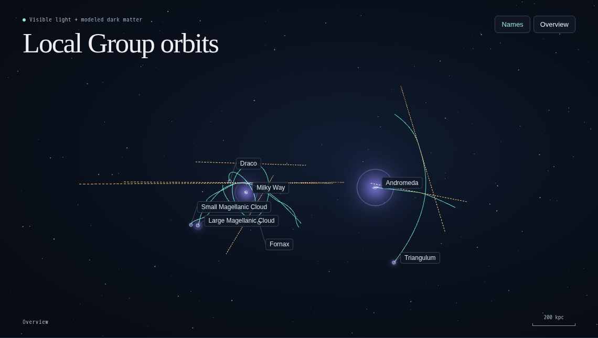

# Local Group Explorer

Where is the Triangulum Galaxy (M33) in relation to Andromeda (M31), and how might their separation change over the next two billion years? Local Group Explorer lets you explore our galactic neighbourhood in 3D and compare the motions we measure today with the paths that gravity could produce.

*One possible Local Group configuration two billion years from now, captured in the simulator. The solid turquoise tracks include mutual gravity. The dashed amber tracks extend the same present-day velocities in straight lines. Violet shows the modelled dark matter halos.*

## About the project

If you have seen M31 and M33 through binoculars, you know their positions against the stars. This browser-based atlas lets you leave that line of sight, turn the group edge-on and see the depth that a sky chart flattens. The present-day catalogue contains 23 galaxies. Seven have both initial velocities and explicit mass models in the gravitational simulation. These are the Milky Way, Andromeda, Triangulum, the Large and Small Magellanic Clouds, Draco and Fornax. The catalogue guide explains the selection and how it relates to published counts of Local Group members. [Catalogue and coverage](docs/catalog.md)

## What you can explore

- **The geometry of our neighbourhood.** Rotate around the plane through the centres of the Milky Way, Andromeda and Triangulum. Follow their companions above or below it, or view an individual galaxy along the line of sight from Earth.
- **Two scales of time.** Explore ten million years either side of today using measured velocities and illustrative stellar rotation where data are available. Switch to mutual gravity to follow the seven galaxy centres up to two billion years into the past or future. Watch the Milky Way–Andromeda distance change as the clock runs.
- **A dwarf galaxy and its halo.** Compare Draco's luminous body with its modelled dark halo. Hide the halo to examine the stars. Its mass continues to affect every orbit. You can also enlarge faint companions or highlight a single dwarf in a crowded field.

## Observations and model assumptions

The atlas places galaxies using their sky coordinates and estimated distances. Their visible shapes are reconstructions with illustrative stellar points and spiral arms. At the initial size and separation settings, diameters and distances use the same scale. Logarithmic sizing exaggerates small galaxies so you can pick them out. [Geometry and visual references](docs/catalog.md)

Draco illustrates how a measurement enters the simulation. Its stellar motions imply about **21 million solar masses inside 291 parsecs**, the radius enclosing half its light. That figure includes stars and dark matter. To calculate Draco's pull on distant galaxies, the simulator adopts a halo profile extending beyond those stars. The resulting total dark mass of about **233 million solar masses** depends on that choice. [Wolf et al., enclosed mass estimates](https://arxiv.org/abs/0908.2995) · [Halo calibration](docs/gravity.md)

The long-term orbits show one scenario with fixed masses and initial velocities. Uncertainty in those inputs, tidal mass loss and dynamical friction all matter when interpreting close encounters. The displayed paths cannot establish the date or outcome of a future merger. [Motion measurements](docs/motion.md) · [Gravity model and numerical checks](docs/gravity.md)

## Data, references and credits

- **Positions, distances and sizes.** The nearby galaxy catalogue and the versioned Local Volume Database provide the observational basis for the map. [McConnachie (2012)](https://arxiv.org/abs/1204.1562) · [Local Volume Database v1.1.2](https://github.com/apace7/local_volume_database/releases/tag/v1.1.2)
- **Galaxy motion and mass.** Proper-motion measurements constrain the sideways velocities of M31 and M33. Published mass models inform how strongly they attract their neighbours. Each galaxy's **Model & sources** panel links to its references. [Wu et al., proper motions](https://doi.org/10.1051/0004-6361/202555477) · [Patel et al., mass models](https://doi.org/10.1093/mnras/stw2616)
- **Observations to explore alongside the atlas.** Public Hubble mosaics resolve stars across parts of M31 and M33. Webb observations offer a closer look at stars in the isolated dwarf WLM. [Hubble PHAT](https://archive.stsci.edu/hlsp/phat) · [Hubble PHATTER](https://archive.stsci.edu/hlsp/phatter) · [Webb JWSTSTARS](https://archive.stsci.edu/hlsp/jwststars)

When sharing the original galaxy renderings, credit **Local Group Explorer contributors**. The catalogue guide gives the attribution terms and credits for external images. [Image credits and reuse](docs/catalog.md#visual-references-and-reuse)

## Try it and learn more

[Run the explorer locally](docs/user-guide.md#run-locally) · [Illustrated user guide](docs/user-guide.md) · [Scientific model notes](docs/gravity.md)
