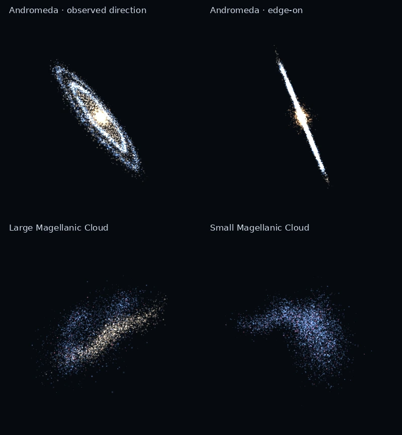

# Adding a galaxy

Start with the Triangulum entry in `src/catalog.ts`. Its record supplies both the catalog card and the 3D scene. The following steps apply to a galaxy with an identifiable optical disk.

1. Copy the entry and give it a unique English `id`, display name and classification. Preserve the published center's J2000 right ascension and declination in degrees. Multiply right ascension in hours by 15 to obtain degrees.
2. Set `distanceKpc` to the distance from the Sun to that center. Set `diameterKpc` to the **full diameter** of the visible structure being modeled. Triangulum uses an estimated 50,000 light-years for its bright stellar disk, converted with `lightYearsToKpc(50000)`. In `sizeNote`, say which structure and brightness boundary the estimate describes. A diffuse stellar halo can extend much farther.
3. Choose the closest existing `model`. For Triangulum, `open-spiral` draws a small warm center, loose blue arms and scattered pink knots. Give the adopted inclination from face-on and the line-of-nodes position angle measured east of celestial north. Triangulum uses 54° and 23° from Table 6 of Sasaki et al. A new shape belongs in `src/models.ts` only when the existing models cannot convey the observed structure.
4. In `modelNote`, distinguish the features observed in the reference from choices made for their reconstruction. Record the source and credit for each measurement, viewing angle and optical reference in `sources`. Link to the original publication or image record. For any redistributed image, also record its creator, license, required attribution and modifications alongside the file.
5. Open the new galaxy from the catalog at both scale settings of 1×. Compare the apparent tilt, angular proportions, core and outline against the reference using the observed view. Orbit around the major axis to inspect its depth, then confirm its label remains accessible in the overview. Run the tests described in the README.

## Coordinates and scale

All positions and diameters use kiloparsecs. A kiloparsec is about 3,261.56 light-years. The present-day reference calculation in `src/physics.ts` converts a sky direction and heliocentric distance into a Cartesian vector. It subtracts the vector to the Galactic center, 8.2 kpc away, so that the Milky Way lies at the scene origin. The positive X axis points toward right ascension 0°, positive Y toward celestial north and negative Z toward right ascension 90°. The Sun’s offset matters especially for the two nearby Clouds. Distances are rounded estimates. [McConnachie, nearby galaxy catalog](https://doi.org/10.1088/0004-6256/144/1/4) · [GRAVITY Collaboration, Galactic center distance](https://doi.org/10.1051/0004-6361/201935656)

Every model occupies a sphere of unit diameter before placement. The catalog diameter and the size control scale its local geometry uniformly. The separation control multiplies all center vectors about the Galactic center. Zoom and orbit operate on the camera. The time model evolves positions from this reference epoch.

## Catalog coverage and dwarf measurements

The explorer includes 23 galaxies. The 18 additions sample the Milky Way and Andromeda satellite populations and five Local Group field galaxies. Their source records in Andrew B. Pace’s Local Volume Database provide measurement uncertainties and citations for the underlying observations. Each card links to its input record at the exact version used. [Pace, catalog methods](https://arxiv.org/abs/2411.07424) · [LVDB v1.1.2, November 2026](https://github.com/apace7/local_volume_database/releases/tag/v1.1.2)

A reproducible **spatial census** gives 114 galaxies. In the v1.1.2 combined table, select rows with `confirmed_galaxy = 1` and `distance_lg <= 1000` kpc from the catalog's Local Group center. The Milky Way satellite table contributes 57 rows (including the Magellanic Clouds), the Andromeda satellite table 42, the nearby field table 12 and the host table two (Andromeda and Triangulum). Add the Milky Way, whose distance field is empty. A distance cut describes a volume. Determining gravitational membership for galaxies near its edge requires additional evidence, and discoveries change the count. [Release table](https://github.com/apace7/local_volume_database/releases/download/v1.1.2/comb_all.csv) · [Column definitions](https://local-volume-database.readthedocs.io/en/latest/usage.html)

To add another dwarf, copy a record in `dwarfs`. Use its LVDB key and the published `ra`, `dec`, `distance`, `rhalf_physical`, `ellipticity`, `position_angle` and `M_V`. The projected half-light radius is the semimajor axis of the ellipse enclosing half the light, in parsecs. We display a diameter of four times this radius. This convention describes a central luminous region. Fainter stars, tidal tails and dark matter can extend beyond it. The position angle fixes the long axis on the sky and ellipticity determines the projected flattening. The model assumes a line-of-sight depth and uses schematic stellar populations. Absolute V-band magnitude describes visible luminosity on the astronomical magnitude scale, where smaller numbers mean more light. [LVDB column definitions](https://local-volume-database.readthedocs.io/en/latest/usage.html) · [LVDB data license, CC0](https://github.com/apace7/local_volume_database/blob/v1.1.2/LICENSE)

All galaxy cards link to the observed optical field in the CDS Aladin sky atlas. For the Milky Way this opens the direction of its center as seen from Earth. Specific public datasets offer additional views.

- **Andromeda and Triangulum.** Hubble's PHAT and PHATTER products include multiband photometry of resolved stars. [PHAT](https://archive.stsci.edu/hlsp/phat) · [PHATTER](https://archive.stsci.edu/hlsp/phatter)
- **WLM.** JWSTSTARS publishes Webb near-infrared imaging and photometric catalogs of individual stars. [JWSTSTARS](https://archive.stsci.edu/hlsp/jwststars)
- **IC 1613.** The VLA LITTLE THINGS survey publishes neutral-hydrogen intensity and velocity products. [LITTLE THINGS](https://science.nrao.edu/science/surveys/littlethings/data/ic1613.html)

## Present-day orientation

**Observed view** looks along the catalog sightline with celestial north up and east to the left. Center coordinates and distances set the relative galaxy positions. Distances carry observational uncertainties. A disk's position angle measures its projected major axis east from north. Inclination measures its tilt from face-on. The catalog uses the direction along the line of nodes for which the nearer minor axis lies 90° earlier in position angle.

- **Andromeda and Triangulum.** The adopted (inclination, position angle) pairs are (77°, 38°) and (54°, 23°). Andromeda's northwest side and Triangulum's western side tilt toward the observer. Measurements of proper motion support counterclockwise and clockwise sky rotation respectively. The models use one representative plane per galaxy. Warps, arm locations and spiral pattern speeds are unresolved here. [Dust in Andromeda](https://arxiv.org/abs/2407.05737) · [Triangulum gas kinematics](https://arxiv.org/abs/0707.2162) · [Gaia rotation measurements](https://arxiv.org/abs/1805.04079)
- **Milky Way.** The pole sets the Galactic plane. The model adopts a 30° bar angle with its nearer end at positive Galactic longitude, within the 28–33° range measured by Wegg and colleagues. The four generated arms trail the adopted disk rotation. Their paths and their phase relative to the Sun are illustrative. [Milky Way bar measurements](https://academic.oup.com/mnras/article/450/4/4050/989881)
- **Magellanic Clouds and dwarfs.** The adopted Large Cloud disk model has inclination 34.7° and node angle 122.5°. Its northeast side is closer. Its bar and knots are schematic. The Small Cloud's depth and tilt are illustrative. The projected flattening and position angles of the added dwarfs use their catalog measurements. [Large Cloud geometry](https://arxiv.org/abs/astro-ph/0105339)

## Visual references and reuse

The models generate their own stellar light distributions from a repeatable random sequence. Point colors, individual concentrations, arm paths and depths are illustrative. The angular orientations and fitted structure in the catalog constrain each reconstruction. The reference photographs remain on their publishers’ sites.

- **Milky Way.** NASA/JPL-Caltech's reconstruction informs the bar and spiral structure. The Galactic north pole fixes the modeled disk plane. [NASA reference](https://science.nasa.gov/resource/the-milky-way-galaxy/)
- **Andromeda.** Robert Gendler's copyrighted visible-light photograph shows a bright central bulge, an elongated disk and darker curved lanes. The model uses these features for the observed-direction comparison. Follow the photographer's terms for reuse of the external image. [NASA APOD image and credit](https://science.nasa.gov/image-article/apod-2009-may-10-m31-the-andromeda-galaxy/)
- **Triangulum.** NASA's Messier catalog shows the loose arms and clumpy star formation and lists the image contributors. Consult the image credit for each component before reuse. [NASA Hubble Messier catalog](https://science.nasa.gov/mission/hubble/science/explore-the-night-sky/hubble-messier-catalog/messier-33/)
- **Magellanic Clouds.** The ESO photograph by M. Zamani supplies a shared reference for their irregular outlines and bright extents. The VMC survey distinguishes the bar, wing and stellar concentrations across the two Clouds. [ESO image and credit](https://www.eso.org/public/images/potw2216a/) · [VMC stellar morphology](https://doi.org/10.1093/mnras/stz2400) · [ESO image usage terms](https://www.eso.org/public/outreach/copyright/)

Original galaxy model renderings are licensed under Creative Commons Attribution 4.0 International. Credit “Local Group Explorer contributors,” link to this project and the license, and identify modifications when sharing an adaptation. This grant covers the project's original renderings. Each external reference retains its own terms. [CC BY 4.0](https://creativecommons.org/licenses/by/4.0/)

## Visual review of the generated geometry

These historical panels predate the correction of the near-side tilt for Andromeda and the Large Cloud. The four panels project the original positions, colors and point widths from `createGalaxyModel`. An offline rasterizer used the Three.js perspective camera, catalog orientation and the point shader’s radial brightness profile. Each panel frames one galaxy individually. These images check the model geometry independently of browser rendering.

- **Andromeda from the observed direction.** The reconstruction and Gendler's reference both show an elongated disk around a warmer, thicker center. The model's bands are more regular and its dark gaps sharper than the mottled lanes in the photograph. [Reference photograph](https://science.nasa.gov/image-article/apod-2009-may-10-m31-the-andromeda-galaxy/)
- **Andromeda edge-on.** Turning the camera to look along the major axis collapses the bands into a narrow disk while the central bulge still protrudes. Across all 22,000 generated points, the ratio of minor to major projected RMS width drops from 0.228 in the observed view to 0.067 edge-on. These dimensionless widths come from the principal axes of the projected positions.
- **Magellanic Clouds.** The large model has a bright offset bar with a patchy extension on one side. The small model has a bent outline and an extended faint wing. Both retain an asymmetric silhouette like the diffuse shapes in Zamani’s wide-field image. The photo and each panel use different framing and exposure. [Reference photograph](https://www.eso.org/public/images/potw2216a/)
