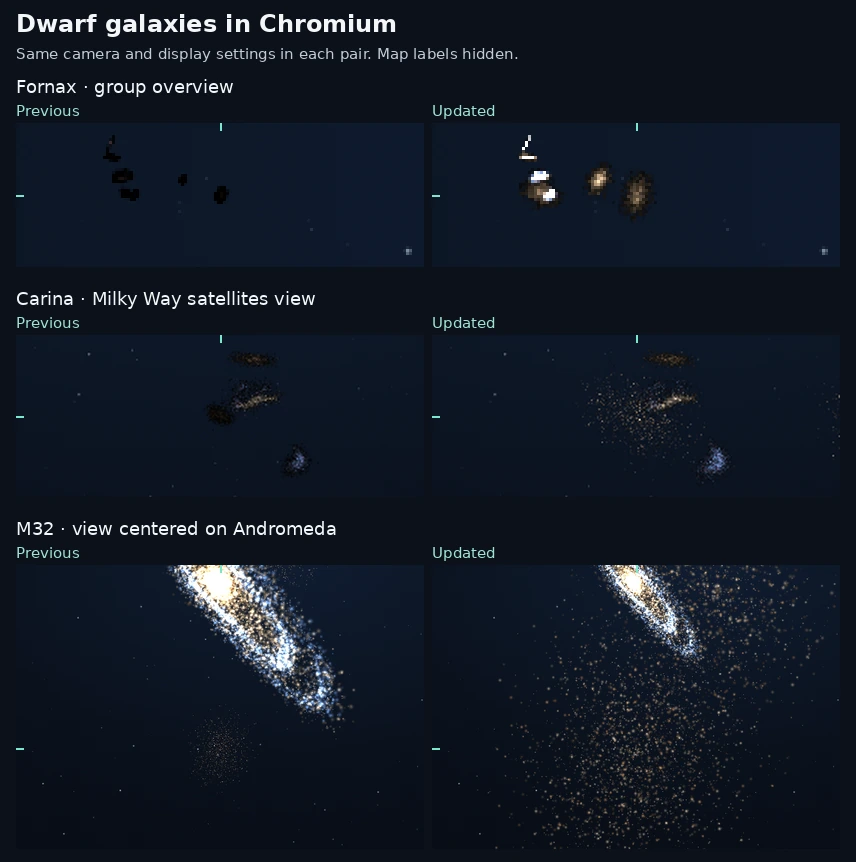

# Dwarf visibility in logarithmic mode

Each pair is cropped from Chromium at the same camera position, orientation, field of view and viewport size. The ticks on the top and left edges locate the dwarf center. Each row has its own crop and display magnification. All six images use the present epoch, a 1440 × 900 CSS-pixel window at device scale 1, logarithmic sizes enabled, and size and separation at 1×. Labels were hidden in both versions. The previous version is commit `a84f196`.

| Target and camera | Projected envelope diameter, previous → updated (pixels) | Visible pixels attributable to the galaxy, previous → updated |
| --- | ---: | ---: |
| Fornax, Local Group overview | 6.2 → 18.9 | 0 → 62 |
| Carina, Milky Way satellites overview | 22.6 → 93.1 | 1 → 430 |
| M32, camera framed on Andromeda | 119.8 → 451.7 | 788 → 12,374 |

The projected diameter is the displayed model diameter converted to pixels at its center depth. For the last column, a second screenshot hid just the target galaxy and retained the same camera and all other scene objects. We counted screen pixels in which adding the target raised at least one red, green or blue channel by 16 or more on the 0–255 scale. The count includes only pixels inside the viewport. All counts use the full-resolution captures before cropping or resizing for the figure.

In the earlier overview, Fornax had a six-pixel envelope but its brightest contribution to the rendered image was two intensity levels. Increasing its nominal diameter alone left the stellar tracers too faint. The updated logarithmic mode compresses the diameter range more strongly, brightens unresolved tracers, and allows each neighbor to grow to 47.5% of their center distance in radius. This fixes a 3D growth limit at each epoch, independent of the size slider. In physical mode, measured sizes and the original tracer intensity are restored. The browser regression test checks visible light around Fornax as well as the gap between every pair of envelopes.
