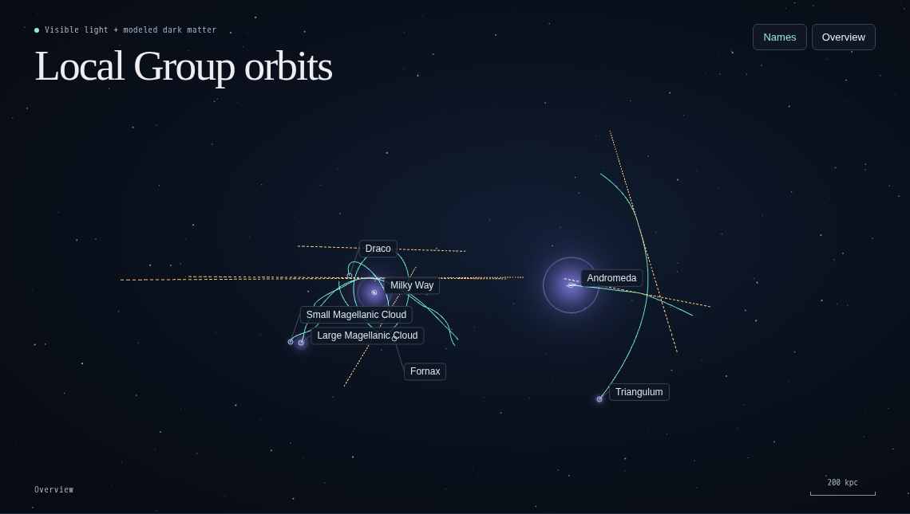
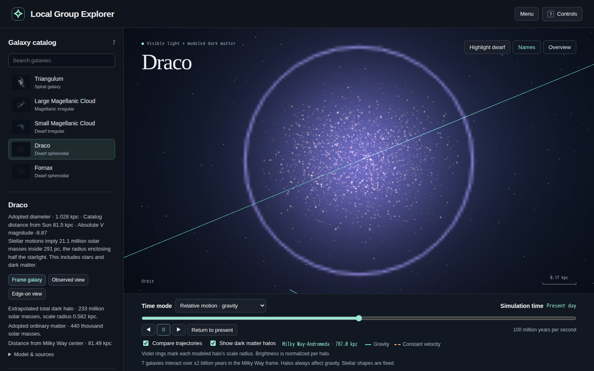

# Exploring the Local Group

Find the galaxy catalog on the left. If it is hidden, choose **Menu**. Select **Andromeda** in the list or click its name on the map. Selection opens a card with its diameter, distance from the Sun and sources. Choose **Frame galaxy** to move close enough to see its structure. On a narrow screen, press **Menu** again to uncover the map.

## Tour 1 · Follow Andromeda and Triangulum through time

1. In **Time mode**, choose **Observed velocities · short term**. Open **Menu → Reference plane → Top view**. The grid passes through the centres of the Milky Way, Andromeda (M31) and Triangulum (M33). Switch to **Edge-on plane view** to see how other galaxies sit above or below that plane.
2. Below the map, choose **Relative motion · gravity**. The catalog now shows the seven interacting galaxies. The Milky Way stays at the centre of the coordinate system. **Compare trajectories** shows a solid green track for gravity and a dashed amber track for motion at constant velocity. Both start from the same present-day positions and velocities.
3. Choose **Return to present**, note the **Milky Way–Andromeda** distance below the timeline, then press **▶**. Watch Triangulum move relative to Andromeda as the distance readout changes. Drag the slider to compare other epochs, up to two billion years either side of today.
4. Toggle **Show dark matter halos** to see how the halos are drawn. Each violet ring marks a scale radius of the adopted mass distribution. The halos continue to affect the orbits when hidden.



The trajectories describe one scenario with fixed galaxy masses. For assumptions about the mass distributions and how the paths are calculated, see the [gravity model](gravity.md).

## Tour 2 · Look inside Draco's halo

1. In **Relative motion · gravity**, choose **Return to present**. Search the catalog for **Draco**, select it and choose **Frame galaxy**. Open its **Model & sources** section to find the measurements used for this dwarf.
2. Read the enclosed mass on Draco's card. Stellar motions imply about **21.1 million solar masses within 291 parsecs** of its centre, a radius containing half of its starlight. That estimate includes both stars and dark matter. The separate **Extrapolated total dark halo** value extends the model beyond the observed region. [Mass measurements and halo assumptions](gravity.md)
3. Switch **Show dark matter halos** off and on to compare the stellar body with the surrounding halo. Scroll out if you want to see more of the halo. The display sets the brightness separately for each halo, so equal brightness in two galaxies can correspond to different densities.
4. Select **Overview** to find Draco in its wider surroundings. Press **Highlight dwarf** to bring out its stars and dim galaxies close to it on the screen. Press it again to restore the original brightness.



## Reading sizes and distances

For a physical comparison, start with **Galaxy size** and **Galaxy separation** at **1×** and **Logarithmic sizes** off. Zooming changes your viewing distance. The size slider enlarges each galaxy around its own centre, while the separation slider spreads the centres away from the Milky Way.

Use **Logarithmic sizes** to spot faint dwarfs. For a crowded view, try galaxy size **4×** and separation **2×**, and toggle **Names** above the map. **Keep galaxy envelopes separate in 3D** limits the growth of close neighbours. Two galaxies at different depths can still appear in front of one another. Rotate the map to see the gap. Distances on galaxy cards are shown in physical units. The scale bar uses kiloparsecs (kpc), each equal to 1,000 parsecs.

## Short-term motion and map controls

The short-term clock covers ten million years on either side of today. Galaxies with an adopted velocity follow a straight path, and disks with rotation data show illustrative internal rotation. To see a small displacement, select **Milky Way satellites → Show motion arrows** in the sidebar. Choose **Since present day**, increase **Arrow length** to **50×** and move the clock. This magnifies the arrows while preserving the physical displacement. [Motion data and coverage](motion.md)

| To | Use |
| --- | --- |
| Orbit a galaxy | Choose **Frame galaxy**, then drag in the map. Scroll the wheel to zoom. |
| Change the viewing angle | **Observed view** returns to the model as seen from the Sun. **Edge-on view** looks along the model's equatorial plane. |
| Fly through the group | Click the map. Use **W/S** for forward/backward, **A/D** for sideways and **Q/E** for down/up. Drag to look around. |
| Recover your bearings | Choose **Overview**, or press **Home** with the map focused. |
| Reset the clock | Choose **Return to present**. Use **◀**, **Ⅱ** and **▶** to run backwards, pause and run forwards. |

## Run locally

Download and extract the simulator source, or use an existing checkout. [Download the seven-galaxy version (ZIP)](https://github.com/juacobarcelo/local-group-explorer/archive/1a800cc83bc1abfe4d0ff34a9afbcef822025a50.zip)

Use Node.js 24, npm and a browser with WebGL 2 enabled. Open a terminal in your copy of the project, alongside `package.json`, and run the following commands.

```sh
npm ci
npm run dev
```

Open the local address printed in the terminal. Keep that terminal open while exploring. Press **Ctrl+C** there when you finish. To try the production build, run `npm run build` and then `npm run preview`, and open the address it prints.
